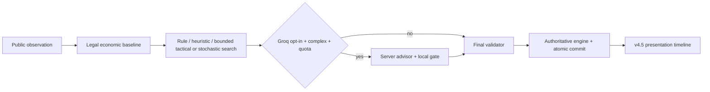

# Monopoli Nusantara v4.6 — NUSA MIND

**Status: kandidat implementasi; belum siap produksi.** Empat model lokal, konfigurasi persona/level, worker, integrasi dan laboratorium sudah dibuat. Verifikasi build/semantic TypeScript belum bisa berjalan karena dependency tidak tersedia. Keunggulan X4 atas baseline dan difficulty ladder belum terbukti; promotion gate menolak promosi. Tidak ada klaim AI superhuman atau Groq yang lebih unggul.

## 1. Source dan hotfix P0

Basis nyata adalah source workspace v4.5, sebelumnya package 4.5.0. Tidak ada .git/branch/HEAD untuk mencocokkan commit Vercel `82184e8` pada `main`. Checkpoint sebelum perubahan disalin ke `/workspace/v46-base`; baseline reproducible disertakan di `benchmarks/frozen-v45` (30 hash cocok). Source ZIP lama/hotfix lama tidak digunakan untuk mengganti proyek.

Tiga error dalam ZIP ditangani pertama: MobileDock sekarang menerima `s={shown}` sehingga tetap menggunakan visual snapshot; financeRows mempunyai kontrak input/result JSDoc shared types agar callback row bertipe; liveCardDecision menerima seat `number|null` secara eksplisit. Tidak ada as any/ts-ignore, strictness tidak dilemahkan, lockfile dan konfigurasi Vercel tidak diubah. Kontrak `reason` optional safe enum dan `aiComment` nullable tetap dipertahankan. Bukti: P0_V46_HOTFIX.md dan fixtures di tests/types.

**Selesai pada kode; semantic TypeScript/build belum terverifikasi.** P0 menjalankan 54/54 tes presentasi setelah hotfix sebelum fitur AI. `npm run build:vercel` exit127 `next: not found`; typecheck exit127 `tsc: not found`; lint exit127 `eslint: not found`; build Sites exit1 modul vinext tidak tersedia. node_modules berisi direktori pnpm tanpa executable. Percobaan koneksi proxy default gagal, permintaan akses jaringan terhenti; tidak mengulang instalasi tanpa perubahan kondisi. Detail V46_BUILD_CHECKS.json. Parser 84 berkas lulus; parser bukan pemeriksaan tipe atau production build.

## 2. Audit source, backend dan Groq

MIND_AUDIT.md berisi 16 temuan konkret, ranking prioritas, kasus reproduksi dan tujuh siklus eksperimen. Engine 40 petak/Nusa, stok bank, ekonomi, ruleset nusantara-c1009-2, engine schema2 dan dukungan save legacy dipertahankan. Timeline dadu → pion → kartu/kejadian → ledger, lifecycle penjara dan public events v4.5 dipertahankan.

Audit akses resmi lingkungan revision29 menunjukkan connected/current, tanpa secret/runtime bindings/outbound identities. Tidak ada tool Supabase/Groq live tersedia. Tidak ada pemeriksaan tabel/RLS/Auth/Realtime produksi atau permintaan Groq sungguhan. Migrasi 001/002 dan room service/job adapter existing ditinjau sebagai source. Uji online menggunakan service/store/HTTP contract doubles dan worker asli, bukan database live.

## 3. Empat model algoritmik dan persona

|Model|Algoritma yang benar-benar dijalankan|Batas awal|
|---|---|---|
|Easy / E1|Rule policy dengan variasi seeded, reserve sederhana dan pilihan investasi legal; safeguards barter/debt memakai fondasi bersama|Tanpa tree search|
|Medium / M2|Evaluator ekonomi existing: nilai set, ROI, reserve dinamis, barter dua pihak, debt beam dan lelang|Tanpa rollout tambahan|
|Hard / H3|Ranking + exact development beam, dilanjutkan dua skenario respons taktis satu fase memakai engine|80 search nodes, target90ms|
|Hardcore / X4|Information-set scenario rollouts, common random numbers, mean/tail utility dan uncertainty promotion gate|160 nodes, maksimum12 batch; target320ms lokal,180ms backend|

Semua menggunakan validator dan command engine yang sama. E1 berbagi legal generator/economic safeguards, tetapi memilih dengan rule policy. H3 mengeksekusi cabang management dan respons, X4 benar-benar mensimulasikan phase transitions. Resource cap dapat diuji dan fallback legal tersedia. Batas waktu kooperatif bisa terlewati sebesar biaya satu evaluasi ekonomi; watchdog luar worker mencegah UI menunggu tanpa akhir. Search node count tidak memasukkan command probes internal legal generator/debt beam.

Raka (investasi), Bima (negosiasi) dan Sari (risiko/blocking) tetap persona lintas-model. Ada 12 kombinasi; persona tidak dipakai sebagai tingkat kesulitan. Default save lama adalah Medium untuk mempertahankan jalur ekonomi sebelumnya. Save schema1 memakai adapter legacy ketika alternatif model belum tersedia.

## 4. Deep Think lokal dan fairness

`lib/bot/mind.mjs` menyediakan `decideMind(state,actor,options)` dan menghasilkan MindPlan: action, candidates, summary dan diagnostics QA. `observation` menghapus deck order/seen/memori lawan dan log privat. sampleWorld mengacak distribusi deck dari definisi publik, menghormati kartu penjara yang sedang dipegang; tidak memakai seed pertandingan atau RNG mendatang. Clone digunakan untuk seluruh simulasi. Evaluator posisi memakai utilitas ekonomi relatif, peluang pendapatan, hazard likuiditas dan hasil kemenangan terminal; **belum merupakan probabilitas menang terkalibrasi**.

Anytime fallback M2 dihitung terlebih dahulu. X4 memperbarui pilihan dari batch berpasangan yang seluruh kandidatnya selesai, sehingga deadline tidak memberi satu kandidat lebih banyak sampel. Challenger harus melewati margin ketidakpastian atas control; hasil beberapa world yang beruntung tidak otomatis menang. Default horizon pendek dipilih sementara setelah uji full/short (5 game X4 masing-masing: full1 kemenangan, short2, baseline2). Sampel ini terlalu kecil untuk klaim kualitas. Full horizon tetap bisa diuji lewat CLI.

## 5. Eksekusi lokal dan online

VS Bot mempunyai selector level setiap persona; jumlah2–4 tetap satu manusia + urutan Raka/Bima/Sari. Pencarian berjalan pada module Web Worker; AbortSignal menghentikan worker ketika context berubah, watchdog1600ms mengembalikan Medium lokal jika worker gagal/tidak menjawab. Worker result harus cocok ID request, match, revision dan actor. Parent thread tetap responsif pada pengujian module worker sungguhan melalui worker_threads; CSP/bundle dan Android browser belum diuji.

Online host memilih level saat ADD_BOT di Waiting; seluruh peserta melihat level. Maksimum6 kursi, minimal2 manusia, maksimal3 persona unik tetap berlaku. Validasi baru menyisakan kursi untuk manusia kedua agar lobby tidak buntu. Bot tidak menggantikan manusia offline, tidak vote/ready dan tidak dieksekusi browser host. Level masuk snapshot dan reconnect.

Job/lease/CAS/receipts existing dipertahankan. runBotWorker memakai model lokal atau advisor, membatasi wait provider secara independen, membaca ulang state/status/actor/revision sebelum commit, lalu satu command otoritatif. Queue/cron backend existing tetap diperlukan. Pause/hold disconnect menahan bot; rekomendasi stale dibuang. Semua ini **selesai dan teruji dengan kontrak lokal**, belum live PostgreSQL.

## 6. Anti-loop dari kasus nyata

Diagnostic lama menemukan siklus BUILD → BUILD_JOIN → seluruh bidder PASS → BUILD, sampai10.000 aksi tanpa kemajuan. `recordBotMemory` menyimpan failed-development fingerprint berisi turn serial, cash/out dan aset. Kandidat BUILD/JOIN yang sama ditahan selama fingerprint tidak berubah; perubahan ekonomi/giliran membuka kembali. Tidak mengubah harga, aturan lelang, bank atau hasil dadu. Empat model lolos regresi snapshot ini dan memajukan giliran dalam <=32 aksi. Memori bounded, serializable, optional pada save lama, dan tetap disembunyikan dari publicState.

## 7. Groq opsional

Flag per-match/room `advisorEnabled` default false, terpisah dari configured ENV. Semua model lokal menyelesaikan permainan tanpa Redis/Supabase/Groq. Jika diaktifkan, momen kompleks dapat mengirim public summary/candidate utility ke endpoint server. Model ENV lama tidak diganti. API key tetap server-only.

Structured actionId divalidasi, decision gate membandingkan kandidat dengan pilihan lokal yang benar, quota/circuit breaker dan safe `reason` dipertahankan. Promise.race membatasi fetch maupun body yang mengabaikan abort. Uji mock mencakup401/403/429/5xx, JSON/aksi ilegal, timeout, jaringan, quota dan fallback. **Tidak ada evaluasi kualitas atau biaya Groq nyata maupun A/B win rate local+Groq.**



## 8. Database, compatibility dan deployment

Migration `202610160003_nusa_mind_settings.sql` menambahkan validasi JSON dan immutability level/advisor sesudah Waiting, serta konsistensi seat/state. Tidak ada tabel/save dihapus atau ekonomi diubah. Migration **belum diterapkan**. Semua state baru menyimpan level dan advisor; field lama yang hilang memakai Medium/false tanpa rewrite data. Bank, rulepack dan game schema tetap sama.

Ikuti DEPLOY_V46.md: dependency CI → typecheck/tests/lint/build → review/apply migration staging → deploy app dan shared Edge worker bersama → verifikasi queue/cron/RLS/Auth/Realtime → aktifkan flag bot setelah QA. Rollback menghentikan bot jobs dan memasangkan app/worker sesuai versi; jangan menghapus room atau mengubah saved state.

## 9. Hasil pengujian nyata

- **350/350 core tests lulus**, 0 gagal, 0 skipped,22 file; QA_V46_RESULTS.json.
- Full `npm test`:357/359 pass,2 gagal karena module TypeScript tidak tersedia pada portrait/render artwork;0 skipped. Test tetap ada. React DOM asli membutuhkan dependency lengkap.
- 45 tes NUSA MIND mencakup12 kombinasi, illegal/malicious trade safeguards, hidden information, budget/cancel/watchdog, worker thread asli, save/load,6-seat config, pause/resume, hung advisor, fingerprint loop dan promotion gate.
- 1.800 command dibanding baseline v4.5: rules/economy/public events/RNG identik setelah mengabaikan metadata bot/advisor/memory. MIND_ENGINE_PARITY.json.
- 30 hash frozen baseline cocok. Tidak ada install ulang browser atau dependency yang digunakan untuk membuat klaim tes palsu.

## 10. Evaluasi utama held-out

Seed base480000, initial RNG LCG, rotasi kursi, ukuran2/3/4 dan persona berganti; tuning seeds terpisah. Budget600s, max6000 actions, node cap160. **120 dimulai,119 selesai,0 aksi ilegal**. Satu X4 terakhir terpotong budget global dan tetap dihitung0 kemenangan. Rerun terpisah seed482118/seat0 selesai pada1611 aksi dan kalah; statistik cohort awal tidak diubah.

|Model|Game|Selesai|Menang|Win rate|Wilson95 deskriptif|
|---|---:|---:|---:|---:|---|
|baseline|24|24|12|50.0%|31.4–68.6%|
|easy|24|24|12|50.0%|31.4–68.6%|
|medium|24|24|12|50.0%|31.4–68.6%|
|hard|24|24|12|50.0%|31.4–68.6%|
|hardcore|24|23|11|45.8%|27.9–64.9%|

Paired X4−baseline **−4,17 poin persentase**, cluster bootstrap95 **−13,04 hingga0,00 poin**,24 pasangan dalam9 cluster seed/ukuran. Interval memperhitungkan korelasi rotasi; sampel belum300 per kondisi. M2 identik dengan baseline dalam cohort ini; H3 jumlah menang sama, urutan kekuatan tidak terbukti. Beberapa timing evaluasi berjalan bersama proses laboratorium lain; profil terisolasi berikut menjadi referensi CPU.

**Gate keunggulan kompetitif gagal. X4 tidak dipromosikan sebagai champion.** Algorithmic distinction tidak cukup untuk mengklaim peningkatan kekuatan. Default Medium dipertahankan. MIND_EVALUATION.json/CSV memuat seluruh run, per-persona/per-size, income/build activity, auction premium, trade count, latency, search work dan kegagalan. Aktivitas build/income bukan pembuktian ROI kausal.

## 11. Eksperimen lain dan kegagalan

|Eksperimen|Dimulai / selesai|Catatan|
|---|---|---|
|Tuning awal|57 /55|0 ilegal;1 action cap,1 wall budget; X4 awal lebih lemah. Harness awal menghitung hash saat akhir sementara source sedang ditingkatkan; jangan pakai hash tersebut sebagai bukti final-policy reproducibility.|
|Recovery diagnostic|4 /3|Kasus10.000 aksi dipakai menemukan failed-development loop; source lama tidak di-retrofit sebagai baseline.|
|Full vs short selection|20 /20|10 per variant termasuk kontrol; ukuran sampel kecil, hanya pemilihan sementara.|
|Self-play lokal|14 /13|Satu Medium terpotong wall budget; rerun seed495093/seat1 selesai250 aksi dan menang. Cohort asli tetap menyimpan truncation.|
|Liga campuran2/3/4|9 /9|Semua model ikut fase permainan;0 ilegal.|
|Liga enam peserta corrected|6 /6|Semua selesai;0 ilegal. Ini engine simulation, bukan6 perangkat live.|
|Ablation|10 /10|Full/no_opponent/no_lookahead/no_risk/no_memory masing-masing1/2 menang; belum ada bukti kontribusi kausal.|
|Lawan random legal|10 /10|H3/X4 menang10/10; baseline lemah ini tidak membuktikan keunggulan atas bot kompetitif.|

Detektor siklus lab awal lupa `starting.pending/scores`, sehingga6 uji awal liga salah dianggap berulang setelah8 opening actions. Temuan diperbaiki di lab, regression test ditambahkan,6 cohort dijalankan ulang. Artefak awal disimpan dengan catatan; enam kegagalan harness tidak disembunyikan atau dianggap deadlock produksi. `no_risk` menghapus tail/hazard search, reserve evaluator root tetap ada. `no_memory` merupakan ablation lab, bukan setting produksi.

## 12. Profil CPU dan resource

15 pengulangan untuk masing-masing5 fase ×4 model. Angka berikut mengambil **fase terberat tiap model**, bukan percentile gabungan semua aksi.

|Model|max p50 fase (ms)|max p95 fase (ms)|max terukur (ms)|
|---|---:|---:|---:|
|easy|25.81|35.18|35.18|
|medium|22.82|28.84|28.84|
|hard|97.34|104.10|104.10|
|hardcore|33.97|44.63|44.63|

Profil terisolasi Node24 cloud, maxRSS 86.8MiB seluruh proses. Ini bukan tambahan memori per bot, Android FPS, atau batas latensi absolut. Fase debt merupakan biaya besar; H3 dapat melewati target90ms karena satu evaluasi beam tidak dipreempt. Web Worker + watchdog luar menangani isolation; perbaikan slicing evaluator merupakan pekerjaan lanjutan.

## 13. Sepuluh postmortem keputusan

Review tuning menghasilkan24 state/action unik dan11 counterfactual-regret cases. Setiap kandidat diuji dengan12 world publik berpasangan, horizon28 command dan baseline response policy; angka adalah utilitas posisi internal. Snapshot, seluruh kandidat, policy dan diagnostik tersedia di MIND_TUNING_review.json. **Ini diagnosis model terbatas; bukan bukti bahwa alternatif pasti memenangkan game.** Delapan kasus regret juga ditemukan pada18 review unik cohort final.

|#|Match / revision|Policy|Dipilih|Alternatif hasil simulasi lebih baik|Selisih utilitas estimasi|
|---|---|---|---|---|---:|
|1|mind-461093-1 / v573|easy|BUILD 23|BUILD 24|11632|
|2|mind-461093-0 / v370|easy|BUY |AUCTION |4016|
|3|mind-461093-2 / v191|hard|BUILD 39|ACK |1911|
|4|mind-461093-2 / v248|easy|BID 1120|MORTGAGE 9|1429|
|5|mind-461062-1 / v42|baseline|BID 1680|BID 1790|879|
|6|mind-461062-1 / v44|baseline|BID 1700|BID 1790|864|
|7|mind-461093-2 / v259|hard|BUILD 37|AUCTION |778|
|8|mind-461093-0 / v263|easy|BID 550|BID 130|566|
|9|mind-461093-2 / v204|baseline|BID 2230|PASS |510|
|10|mind-461093-2 / v201|baseline|BID 2210|PASS |482|

Pola diagnosis: building selection/tempo dapat terlalu optimistis, pembayaran lelang memerlukan resolusi cukup panjang, dan mean/tail future utility masih bias terhadap rollout policy. Perbaikan fairness/anti-loop teruji; optimalitas negosiasi multi-aset dan evaluator menang tetap topik riset.

## 14. Perintah reproduksi

```sh
npm run test:core
npm run test:mind
npm run test:experience
npm run test:bots
node scripts/verify-mind-baseline.mjs
npm run profile:mind -- --repeats=15
npm run benchmark:mind -- --seeds=4 --players=2,3,4 --seconds=600 --seed-base=480000 --output=docs/MIND_EVALUATION.json
npm run benchmark:mind -- --mode=self --models=easy,medium,hard,hardcore --seeds=1 --players=2,3,4 --seconds=110 --seed-base=495000
npm run benchmark:mind -- --mode=league --models=hardcore --players=6 --seeds=1 --seconds=120 --seed-base=497000
npm run benchmark:mind -- --mode=ablation --models=hardcore --players=2 --seeds=1 --seconds=100 --seed-base=490000
npm run benchmark:mind -- --models=hard,hardcore --opponents=random --players=2,3 --seeds=1 --seconds=50 --seed-base=499000
node scripts/review-mind-traces.mjs docs/MIND_EVALUATION_traces.json
```

Gunakan --output terpisah untuk setiap eksperimen. Wall-clock budget dan performa hardware dapat mengubah fallback search/cohort terakhir; seed dan node budget memberi dasar reproduksi, bukan jaminan durasi identik lintas perangkat. CLI --seat mendukung rerun terarah. `promotionGate` hanya melaporkan evidence threshold (>=300 X4 game, finish>=99%,0 ilegal, positive clustered lower bound); tidak mengubah produksi.

## 15. File dan status acceptance

File utama: lib/bot/mind-config.mjs, mind.mjs, mind-client.mjs, mind.worker.mjs, contracts.ts, candidates/analysis/memory/strategy/personas; Game.tsx; game/save-format/finance/presentation-timeline/groq; server online-room/bot-worker; migration003; scripts lab/profile/review/verify; regression tests/fixtures. Daftar lengkap MIND_CHANGED_FILES.json.

|Gate|Status|
|---|---|
|P0 tiga kontrak diperbaiki|Selesai pada kode; build/typecheck belum terverifikasi|
|Empat model +12 persona-level|Selesai dan teruji lokal|
|Deep Think offline, bounded worker + fallback|Selesai dan teruji melalui engine/actual thread; browser Android belum terverifikasi|
|Barter, lelang, build, debt, jail, cards|Selesai dan teruji lokal; optimalitas global tidak diklaim|
|Online setting/authoritative worker/pause/reconnect|Selesai dan teruji kontrak lokal; Supabase live belum terverifikasi|
|Groq adapter/guard/fallback|Selesai dan teruji mock; kualitas provider nyata belum terverifikasi|
|Ladder / X4 superiority / promotion|**Belum selesai / belum terbukti**|
|TypeScript, lint, Vercel/Sites production build|**Terhalang lingkungan**|
|Deployment / migration produksi|Tidak dilakukan|

## 16. Checklist QA manual dan riset lanjutan

- [ ] Install dependency pada CI resmi; semua tsc/tests/lint/build termasuk build:vercel harus lulus, jangan mengabaikan error berikutnya.
- [ ] VS Bot2/3/4 dengan level tiap persona, nama/pion tetap; offline setelah worker/aset tercache; CSP worker dan fallback; save/load lama/baru.
- [ ] Pause saat worker berpikir, pindah menu/room, refresh, double tap dan stale revision tidak menerapkan aksi lama.
- [ ] Dadu reveal → pion → kartu → Nusa/riwayat, jail popup sekali, observer kartu tanpa tombol actor, mortgage/house/hotel HUD tetap benar pada Android portrait/reduced motion.
- [ ] Online2 manusia,2+1 bot,2+3 bot,3+3 bot,6 manusia; semua level terlihat sebelum start dan tidak berubah selama match.
- [ ] Auth seat ownership, RLS/cross-room denial, concurrent job invocation, expired lease, retry idempotency, worker crash/cron recovery live.
- [ ] Host disconnect, all-offline90s, critical decision hold, majority-human pause dan all-human ready resume; bot tidak bertindak saat paused.
- [ ] Groq nyata opt-in berbudget kecil: configured vs success, error/429/quota fallback, local+Groq A/B terpisah dari mock; jangan jalankan biaya besar tanpa konfigurasi tepat.
- [ ] Evaluasi >=300–1000 held-out game **per kondisi**, lebih banyak seed/seat/opponent, opponent/memory/risk/search ablation lebih kuat. Kembangkan acceptance-aware trade proposal dan evaluator future income/solvency yang kurang bias; promosi hanya jika confidence gate lulus.

Source ZIP/patch berisi implementasi nyata dan seluruh bukti yang disebut, termasuk eksperimen gagal. Build atau multiplayer production-ready tidak diklaim.
