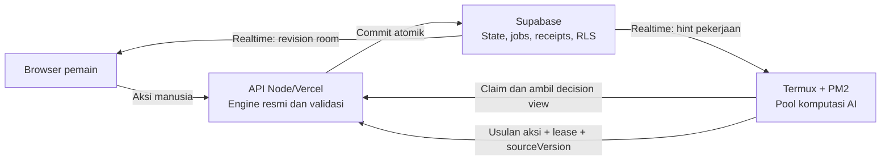

# Revisi rencana: Termux Online AI Worker

Tanggal: 18 Oktober 2026. Dasar audit source: commit `af88d14a08815ee1d139bbf5a9b945a24126d348`, aplikasi 4.11.0, NUSA V23. Dokumen ini memperluas [rencana fix loop](NUSA_V23_FINANCE_LOOP_AUDIT.md); tidak menggantikannya. Status: **rancangan integrasi, belum implementasi atau deployment**.

## 1. Keputusan utama

Komputasi keputusan AI dipindahkan ke Termux. API Node/Vercel yang sudah ada tetap menjadi otoritas engine aturan, sedangkan Supabase menangani persistence, Auth/RLS, antrean durable, lease, transaksi, dan sinkronisasi. Edge Function tidak diperlukan untuk jalur normal bot.



Termux tidak mengirim state pengganti, hasil dadu, kartu, saldo, atau RNG. Ia mengirim **intent aksi**. API membaca state terbaru, menjalankan `command()`, kemudian Supabase mengesahkan commit dengan pemeriksaan versi/lease dan receipt unik.

Pembedaan ini penting: RPC SQL saat ini memvalidasi envelope, membership, lease, version, dan atomicity; ia **tidak menjalankan seluruh aturan Monopoli dari JavaScript**. Mengizinkan Termux langsung memanggil RPC commit state akan melemahkan otoritas game. Memindahkan reducer ke SQL tidak diperlukan dan berisiko membuat dua implementasi aturan berbeda.

Beban AI hilang dari Supabase Edge, tetapi request API, database, Realtime, dan bandwidth tetap perlu diukur. Klaim “gratis/tanpa beban” atau “kecepatan dan kecerdasan selalu sama pada setiap HP” bukan kriteria yang dapat dijamin tanpa pengukuran kapasitas perangkat.

## 2. Temuan source yang menentukan rancangan

| Komponen saat ini | Temuan | Perubahan yang direncanakan |
| --- | --- | --- |
| `lib/server/bot-worker.mjs` | Sudah ada pemilihan actor lelang/buildOffer/rent/trade, recheck versi, fallback, dan commit fenced; planner lokal memakai budget 180 ms | Pisahkan komputasi dari claim/validasi/commit; reuse actor dan aturan fairness |
| `lib/server/supabase-store.mjs` | Seluruh akses store memakai service-role/secret | Tetap server-only; jangan dibundel sebagai koneksi privileged Termux |
| Migration 002 + 006 | Ada `mn_bot_jobs`, lease 30 detik, `mn_bot_actions`, receipt, room CAS | Tambah identitas worker, scope, fencing, capability, dan API claim/submit terbatas |
| Trigger/scheduler | `mn_notify_bot_job` memanggil `mn_wake_bot_worker`, diarahkan Vault ke Edge; cron recovery satu menit | Mode Termux mematikan wake Edge secara eksplisit, mempertahankan job durable dan jalur recovery pull |
| `app/api/online/route.ts` | ADD_BOT mensyaratkan worker Vault/Edge dan scheduler siap | Capability memeriksa provider Termux, heartbeat, versi kompatibel, dan kapasitas; tidak lagi menuntut Edge aktif |
| `online-room.mjs` + migration 006 | Enam persona dikenal, ARKA memakai ID `apex`; batas online saat ini 3 bot dan minimal 2 manusia | Pertahankan komposisi online ini untuk migrasi awal; seluruh enam persona dapat dipilih lintas match |
| `frontend/session.mjs`, `online-client.mjs` | Browser memakai Realtime revision hints, read ulang, heartbeat 10/20 detik | Pertahankan alur manusia; tampilkan status worker/antrean yang aman tanpa menjalankan AI online di browser |
| `lib/groq.ts` | Menghitung planner lokal lagi dengan budget 180 ms sebelum advisor; timeout default 6.500 ms | Pisahkan adapter advisor agar menerima plan dari Termux, tanpa menghitung ulang AI di server |
| Adapter Node/Vercel dan build | Endpoint diseleksi eksplisit di router, handler Vercel, rewrites, build module graph | Endpoint worker wajib terdaftar di seluruh jalur, bukan hanya membuat file route baru |

Audit ini membaca source dan migration di repo; belum memverifikasi migration mana yang benar-benar terpasang pada proyek Supabase live. Preflight live akan menjadi langkah implementasi sebelum aktivasi. Tidak ada credential Supabase proyek yang tersedia dalam sesi ini.

## 3. Sumber kebenaran model dan batas perubahan

1. Model terbaru yang **tersedia dalam sesi ini** adalah source V23 di repo dan ZIP benchmark. Seluruh 38 file bot ZIP cocok dengan repo. Belum ada lampiran model baru setelah ZIP tersebut; jangan menganggap V24 atau versi lain tersedia.
2. Buat manifest versi dan SHA-256 per file untuk NUSA, KRESNA, ARKA (`apex`), RAKA, BIMA, SARI serta shared planner. Termux dan backend menyepakati `modelManifest`, `engineVersion`, dan `protocolVersion` sebelum menerima job.
3. **Porting runtime tidak mengubah algoritma model.** Transport, worker threads, PM2, dan monitoring dibungkus di luar model. Dilarang mengganti persona dengan model lama/random bot atau memangkas pencarian diam-diam saat perangkat sibuk.
4. Fix loop yang sudah disetujui tetap dikerjakan sebagai **patch perilaku terpisah dan berversi**, dengan diff, checksum sebelum/sesudah, dan regression. Koreksi scorer/policy memang mengubah keputusan; hasilnya tidak akan diklaim sebagai model byte-identik tanpa perubahan. Integrasi runtime diuji dengan baseline terlebih dahulu, lalu release final menggunakan versi bugfix yang terdokumentasi.
5. Jika lampiran lebih baru tersedia saat implementasi, lakukan inventarisasi/diff lebih dahulu, kemudian terapkan hanya bugfix yang masih relevan. Tidak menyalin campuran folder dari dua versi tanpa manifest.

## 4. Protokol worker dan keamanan

- CLI melakukan enrollment memakai kode pairing sekali pakai atau identitas operator yang diotorisasi backend. Hasilnya identitas perangkat dan credential worker terbatas, dapat dicabut/dirotasi, terikat scope room/group serta versi yang diizinkan. Token biasa milik pemain tidak otomatis menjadi worker.
- Pilihan implementasi identitas: akun Supabase Auth perangkat yang diregistrasikan pada server, dengan token sesi untuk API dan RLS khusus **wake hints**. Otorisasi worker disimpan di tabel server, bukan metadata user yang dapat diedit sendiri. Refresh token dibatasi identitas itu dan disimpan privat pada perangkat.
- Akses langsung Realtime hanya membaca notifikasi minimal yang diizinkan RLS. Jangan membuka SELECT atas seluruh `mn_rooms`, `mn_bot_jobs`, identitas pemain, atau memory privat agar worker bisa subscribe.
- Claim/submit tetap melalui endpoint Node terpercaya; worker tidak mendapat izin `mn_commit_room` atau seluruh RPC service-role. Server memeriksa registrasi/scope pada claim dan submit, termasuk pencabutan credential.
- Tidak ada `SUPABASE_SERVICE_ROLE_KEY`, `SUPABASE_SECRET_KEY`, database password, signing secret, atau token Vault Edge dalam ZIP, `.env` Termux, output terminal, maupun frontend. Kredensial admin hanya berada pada backend/config deployment yang sudah sesuai.
- Snapshot job berupa **decision view** sesuai informasi yang boleh dilihat model: hilangkan urutan deck/RNG, token, koneksi manusia, dan memory privat lawan. Backend memegang state canonical untuk validasi dan randomness.
- Token, pairing code, dan Authorization dihapus dari log. File config privat dibuat dengan permission terbatas, bukan disimpan di shared storage Android. Reconnect/refresh tidak memicu login interaktif berulang.

### Siklus pekerjaan

1. Hint Realtime atau recovery scan membangunkan scheduler Termux. Hint bukan bukti job masih valid.
2. API claim melakukan operasi atomik dan mengembalikan job, lease/fencing token, actor, `matchId`, `sourceVersion`, deadline, manifest, dan decision view yang konsisten. Reuse `FOR UPDATE SKIP LOCKED`; jangan membuka transaksi selama bot berpikir.
3. Termux menghitung aksi di pool `worker_threads`; main thread tetap melayani heartbeat/reconnect. Satu room diproses serial, room berbeda dapat berjalan paralel sesuai slot perangkat.
4. Submit menyertakan action intent, lease, actor, match/version, command ID, dan diagnostik kecil. API memeriksa schema/allowlist, scope, lease, gameplay hold, actor aktif, versi, dan legalitas melalui engine resmi. Metadata broker/finance yang diperlukan hanya dipertahankan lewat allowlist tervalidasi; worker tidak boleh menyisipkan state atau memory arbitrer.
5. RPC melakukan CAS, fencing, dan insert receipt unik secara atomik. Retry dengan command ID sama mengembalikan hasil sebelumnya; tidak melempar dadu atau membayar dua kali. Network tetap dapat mengirim ulang, tetapi efek commit dijamin paling banyak satu per sourceVersion.
6. Response dapat menyertakan job berikut yang sudah di-claim secara sah jika masih tersedia slot. Setiap aksi tetap satu transisi canonical; tidak membuat batch aksi spekulatif yang melewati respons manusia.

Lease harus terikat worker, room, match, actor, sourceVersion dan generation/token. Nilai awal 30 detik dievaluasi terhadap antrean + search + submit. Job hanya di-claim ketika slot hampir tersedia; jangan menyandera banyak room dalam antrean lokal. Heartbeat kehadiran worker dipisahkan dari renewal lease pekerjaan.

Heartbeat manusia dapat mengubah room revision tanpa mengubah game version. Hasil AI tidak dibuang hanya karena revision heartbeat, tetapi tetap divalidasi ulang untuk perubahan version, actor, match, pause, dan fairness. Fencing saat commit memakai waktu database.

## 5. Responsivitas dan pemakaian Free Tier

- Jalur aksi manusia tidak meng-await bot planner atau Groq. Setelah validasi/commit, respons segera dikirim; bot bekerja asinkron. Aturan yang memang mensyaratkan respons bot lebih dahulu—misalnya klaim sewa manual sebelum roll—tetap dihormati.
- Gunakan satu koneksi Realtime worker untuk hint grup pekerjaan yang diizinkan, bukan subscribe ke semua room atau broadcast full state setiap langkah. Coalesce hint dan claim terbatas kapasitas. Realtime mempercepat; database job tetap sumber kebenaran.
- Recovery poll adaptif dengan jitter/backoff, bukan scan ketat seluruh room. Rancangan awal recovery sekitar 15–30 detik saat koneksi Realtime sehat, lebih jarang ketika benar-benar idle; angka final ditetapkan dari pengukuran. Setelah submit, continuation langsung mencegah jeda polling pada giliran bot beruntun.
- Jangan menambah polling satu detik per room. Dashboard membaca cache/metrik proses; refresh layar tidak memicu request backend.
- Optimalkan round trip: claim+snapshot dalam satu alur, submit+receipt+hint continuation dalam satu respons. Ukur jumlah RPC di baliknya; satu HTTP request belum tentu satu operasi database.
- Fast path hanya untuk keputusan yang terbukti mekanis/terpaksa tanpa alternatif strategis relevan. Fase `roll` sendiri tidak berarti bot selalu harus roll: investasi/trade yang sah tidak boleh hilang demi shortcut.
- Pertahankan budget pencarian model yang dipilih. Profil perangkat menentukan berapa room/slot yang diterima, bukan mengganti model menjadi lebih lemah ketika overload. Tampilkan antrean/busy dan distribusikan ke worker standby bila ada.
- Ukur queue wait, think time, RTT submit, commit, browser receive/render secara terpisah; laporkan p50/p95/p99 pada perangkat referensi. Target awal pada koneksi sehat: overhead p95 di luar think time <1 detik; angka ini target pengujian, belum hasil yang terbukti.
- Hitung egress snapshot, request idle/aktif, Realtime messages, DB writes, dan API duration per aksi/menit. Hindari klaim “Free Tier aman” tanpa estimasi terhadap batas akun saat deployment.

## 6. Reconnect, recovery, dan worker offline

- Putus jaringan: reconnect exponential backoff+jitter, refresh sesi, subscribe ulang, kemudian claim/scan ulang database. Jangan menganggap seluruh hasil cache masih valid.
- Respons submit hilang: query/retry receipt dengan ID sama. Jangan mengulang compute+submit sebagai command baru sebelum mengetahui hasil commit lama.
- Proses mati: PM2 restart; lease lama kedaluwarsa atau dilepas bila shutdown tertib. Worker baru mengambil job dengan fencing baru. Hasil proses lama ditolak setelah takeover.
- Satu room tidak boleh berpikir dua kali secara bersamaan pada worker yang sama; lintas worker diselesaikan lease DB. Pergantian Termux/standby/Edge opsional memakai mekanisme kepemilikan sama.
- Default saat seluruh worker offline: antrean bertahan, frontend menampilkan bot menunggu worker. Aksi manusia yang legal dan independen tetap bisa diproses; keputusan yang memerlukan bot menunggu. Tidak ada langkah bot palsu, perubahan hasil, atau auto-win.
- Standby Termux lain dapat melanjutkan setelah lease habis. Edge emergency hanya opsi eksplisit operator, default **off**; tidak diaktifkan diam-diam sehingga tujuan hemat Edge tetap tercapai.
- Worker liveness tidak menggantikan status pause/disconnect pemain. Aturan fairness, vote, dan resume yang sudah ada dipertahankan.
- PM2 menjaga proses yang masih diizinkan OS berjalan; ia tidak menjamin Android tidak membunuh Termux. Dokumentasi mencakup battery exemption, opsi `termux-wake-lock`, PM2 save/resurrect, dan Termux:Boot opsional. Worker harus pulih aman walau semua mekanisme itu gagal.

## 7. Groq sebagai advisor opsional

Default advisor off; bila aktif, Termux sudah memiliki keputusan lokal sebelum konsultasi. Adapter menerima plan/candidate dari model yang sama dan membatasi hasil Groq ke kandidat yang lolos guard/legalitas. Jangan memakai endpoint `/api/bot` sekarang secara langsung karena menghitung ulang planner di Node.

Untuk rilis awal, `GROQ_API_KEY` tetap server-only pada endpoint advisor khusus worker, dengan scope, quota, circuit breaker, dan deadline pendek. Backend hanya meneruskan konteks/kandidat tervalidasi; tidak menjalankan pencarian model. Timeout/error/rate limit langsung menggunakan hasil lokal yang sudah ada. Hasil advisor yang datang setelah deadline atau setelah sourceVersion berubah dibuang. Aksi mekanis tidak menghubungi Groq.

Advisor tidak wajib meningkatkan pilihan semua persona: router strategis saat ini mengembalikan `shouldConsult:false`. Pertahankan gate yang ada selama migrasi, dokumentasikan persona mana yang memang memakai advisor, dan jangan menambahkan jalur Groq yang mengubah algoritma secara terselubung.

## 8. CLI, PM2, dan monitoring

Entry tunggal: `bash nusa-online.sh`.

Menu yang direncanakan: setup/pairing, mulai worker, stop tertib, restart, cek koneksi/capability, status worker dan room, monitor live, log lengkap, pengaturan slot/profil/advisor, serta recovery konfigurasi.

- PM2 menjalankan **satu daemon worker** dengan nama tetap dan pool komputasi terbatas; bukan satu proses PM2 per bot/room. Start berulang idempotent, stop/restart hanya menyentuh aplikasi ini.
- Mulai konservatif dengan satu slot compute; kalibrasi lokal opsional dapat merekomendasikan slot tambahan menurut RAM, CPU, dan waktu model. Jangan otomatis memakai seluruh core HP.
- Dashboard menampilkan koneksi, umur heartbeat, versi model, slot aktif/antrean, room/fase/persona aktif, throughput, retry/stale/duplicate count, penggunaan memori, dan maksimal **lima event terbaru**.
- ANSI redraw untuk TTY; monitor non-TTY memberi ringkasan berkala singkat. Menutup monitor tidak menghentikan PM2.
- JSONL lengkap disimpan lokal dengan rotasi/retensi; PM2 stdout juga dibatasi. Status refresh tidak menulis ulang log lama atau memenuhi storage tanpa batas.

## 9. Urutan implementasi dan pengujian

| Tahap | Pekerjaan | Syarat selesai |
| --- | --- | --- |
| 0 | Inventarisasi model, alur online, schema/capability live, threat/authority boundaries, ukuran snapshot dan baseline request | Manifest terkunci; perubahan source versus live dipetakan tanpa menampilkan secret |
| 1 | Port baseline model ke runtime Termux terisolasi; pisahkan compute dari API commit; patch loop terpisah sesuai audit | Identitas model port terbukti; regression loop tidak lagi gagal pada versi bugfix |
| 2 | Migration tambahan worker registry/lease/hint, endpoint claim/submit/status/advisor, idempotency | Token pemain/worker tak berscope ditolak; forged state/RNG ditolak; satu efek per versi |
| 3 | Daemon Termux, pool thread, reconnect, fair scheduling, PM2, CLI dan dashboard | Restart/crash/kehilangan ACK dapat dipulihkan; monitor maksimal lima event |
| 4 | Integrasi browser/capability dan mode scheduler Termux | ADD_BOT tidak bergantung Edge; aksi manusia tidak menunggu AI; offline lokal tetap berjalan |
| 5 | Pengujian berlapis dan profil biaya/kinerja | Laporan pass/fail dan metrik; batas perangkat diketahui |
| 6 | Packaging, dry-run instalasi, deployment guide dan rollback | Satu ZIP berisi seluruh artifact yang dibutuhkan; tidak mengandung credential |

Pengujian wajib meliputi:

1. **Model/fix loop:** seluruh snapshot audit, six-persona schedule yang benar, game tanpa NUSA, save/load, scorer tebus, pendanaan build/buy/trade, dan guard pada fallback.
2. **Beberapa bot online:** 2 manusia+3 bot, 3 manusia+3 bot sesuai aturan saat ini; semua enam persona lewat variasi roster. Beberapa room berjalan bersamaan dan tidak ada starvation.
3. **Lelang intensif:** banyak BID/PASS, highest bidder, re-entry yang sah, lelang bangunan, buildOffer, rent claim, trade/counter, debt, dan respons actor di luar pemilik giliran. Respons manusia tidak dilangkahi.
4. **Race/recovery:** dua worker claim serentak, expired lease, restart PM2 saat think/submit, jaringan putus, ACK hilang, duplicate submit, state berubah oleh manusia, pause saat Groq berjalan, JWT refresh/revocation, dan model mismatch.
5. **Offline:** satu/all worker hilang, worker kembali setelah match berubah/selesai, standby takeover, tidak ada hidden Edge wake atau room stuck tanpa status yang jelas.
6. **Database nyata:** isolated PostgreSQL untuk transaksi/RPC dan staging Supabase untuk Auth/RLS/Realtime. Test double saja tidak cukup untuk mengklaim keamanan dan reconnect live.
7. **Perangkat:** uji Termux Android+PM2 sungguhan, screen off/battery management, RAM/log rotation, koneksi Wi-Fi/mobile, dan beberapa profil kapasitas. Hasil Node Linux diberi label terpisah dari hasil Android.
8. **Regresi produk:** offline, aksi manusia, lobby, ready/pause/resume, reconnect browser, save-format, build/typecheck, serta secret scanning artifact/browser bundle.

Tes live tetap memakai staging dan identitas QA terisolasi. Jika lingkungan staging/Android belum tersedia, paket dan harness disiapkan, tetapi laporan akan menyebut pengujian itu belum dijalankan; tidak mengklaim siap operasi dari unit test saja.

## 10. Paket akhir dan aktivasi

Satu artifact akhir: `NUSA_ONLINE_TERMUX_<versi>.zip`, mencakup:

```text
nusa-online.sh
worker/                 daemon, scheduler, pool, protocol, monitoring
models/                 source model terpilih + dependency closure
pm2/ecosystem.config.cjs
config.example.json     tanpa secret atau pairing token
backend/                patch/source API dan integrasi build yang cocok
supabase/               migration tambahan, aktivasi mode dan rollback
frontend/               patch/source capability dan status worker
tests/                  selftest, integration/fault harness
docs/                   instalasi Indonesia, deploy, recovery, batas kapasitas
MODEL_MANIFEST.json
VERSION.json
SHA256SUMS.txt
```

Installer memeriksa Node 24+, bash, PM2, dependency dan checksum; instalasi pertama mungkin memerlukan internet. Jalankan dari direktori privat Termux. ZIP tidak dapat mengaktifkan backend/Supabase otomatis tanpa konfigurasi pemilik: dokumentasi harus memisahkan setup backend sekali, deploy migration/API/frontend, pairing perangkat, dan operasi harian satu CLI.

Aktivasi bertahap: deploy backend/migration backward-compatible → enroll dan health-check Termux → canary room dengan lease provider eksklusif → pilih mode Termux dan nonaktifkan trigger/cron wake Edge → verifikasi request/billing/latency → perluas room. Semua tipe capability membedakan configured, alive, compatible, available/busy. Flag `MN_ONLINE_BOTS_ENABLED` tetap dihormati.

Rollback mengganti provider secara eksplisit, menghentikan claim baru dan membiarkan lease drain/kedaluwarsa; tidak menghapus room/job/receipt aktif. Worker Edge lama hanya boleh menjadi target rollback jika tetap kompatibel dengan engine/model/protokol dan bugfix yang diwajibkan. Jangan otomatis kembali ke model lama demi menjalankan rollback.

## 11. Status revisi ini

Rencana sudah diselaraskan dengan source aktual, tujuan hemat Edge, keamanan tanpa admin credential di HP, serta audit loop sebelumnya. Tahap implementasi, ZIP final, migration live, dan pengujian Termux/staging belum dikerjakan dalam pembaruan rencana ini.
