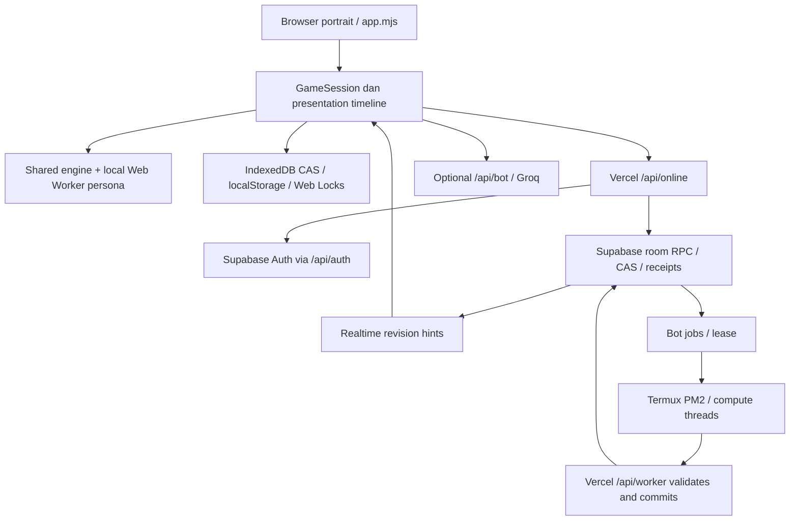

# Peta fitur, source dan deployment

Node 24.19.0, Playwright 1.58.2 / Chromium 145 headless Linux; source 6b237b4c7bc1cd133d74b7585ba011e1d8ba261c, v4.11.6; build 392170ce55b1d147. Tanggal 19 Oktober 2026 UTC.

Clone bersih dibuat pada branch `qa/full-audit-2026-10-19`. HEAD `6b237b4` (pesan commit `y`), parent rilis `7f81589` (`4.11.6`). Proyek native ESM tanpa dependency runtime; TypeScript dipakai pada sebagian adapter/server, diubah saat build. `dist` berisi 103 modul browser reachable, `server-dist` 74 modul server privat. Node 24.x sesuai package.json.

| Fitur/dependency | Implementasi aktif | Bukti eksekusi / status |
|---|---|---|
| Lobby VS Bot 2–6 | frontend/app.mjs, personas.localPlayers | PASS lima ukuran roster lewat UI |
| Enam persona | Raka/Bima/Sari: decideMind; NUSA: V23 Chronos/Kairos; Arka: APEX-JS-3.0; Kresna: V2.0 | PASS benchmark semua persona; model tidak diubah |
| Engine schema 2 | lib/game.mjs + content.mjs, rulepack nusantara-c1009-2 | PASS invariant per aksi; legacy schema 1 punya reducer sendiri |
| Board/pion/kamera | frontend/board.mjs, board-camera.mjs, assets | PASS portrait umum; FAIL layar sangat pendek |
| Uang, rumah/hotel, gadai | game.mjs, finance.mjs, build-batch.mjs | PASS headless + UI fixture, termasuk double-click bangun |
| Lelang terbuka | game.mjs, auction-view.mjs | PASS transaksi UI; suite lama FAIL pada ekspektasi modal hasil |
| Barter dan receipt 4.11.6 | trade-command.mjs, TradeResults, shared popup | FAIL footer stale; PASS transfer/sudut pandang/persistensi terukur |
| Save lokal | storage.ts, IndexedDB CAS + localStorage, Web Locks | PASS suite inti; tab race browser di suite tambahan |
| PWA/offline | service-worker.js, pwa.mjs, precache | PASS suite PWA + reload production offline pada profil QA |
| Backend | Vercel api/index.mjs -> server-dist; /api/auth,/online,/bot,/worker | PASS endpoint/config/Auth dan dua sesi live |
| Room authoritative | online-service.mjs, online-room.mjs, Supabase RPC CAS/receipt | PASS wrong-turn, duplikat request, stale version dan snapshot live |
| Realtime | Supabase mn_room_updates; WebSocket memberi revision hint; HTTP recovery | PASS pesan WebSocket dan sync dua konteks; reordering live belum diinjeksi |
| Termux | PM2/daemon, compute threads, restricted worker protocol, Supabase jobs | FAIL availability live: offline/0 slot; PASS 67 test lokal |
| Edge worker | supabase/functions/monopoli-bots/_shared | Source relevan cocok; runtime Edge aktif tidak terbukti, provider live Termux |
| Groq advisor | /api/bot, kuota, fallback lokal | GET configured:true model gpt-oss-120b; panggilan berbayar tidak dipaksa |
| Migrasi/RLS | delapan SQL migration 001–008 | Source ditinjau; live capabilities schemaVersion 7; katalog DB/RLS tidak diakses langsung |

## Alur dependency

## Kecocokan versi

- Production `/build.json` dan build clone sama: **4.11.6 / 392170ce55b1d147**.
- Tujuh file publik diunduh dan SHA-256 dibandingkan byte demi byte: app, session, CSS, trade-results, engine, wrapper barter, service worker. Semua cocok: [production-file-comparison.json](evidence/production-file-comparison.json).
- `/api/worker` mengumumkan protocol/manifest yang cocok. Receipt barter live berstruktur membuktikan fitur backend 4.11.6 tersedia. Endpoint publik tidak memberikan commit SHA backend; kesamaan byte keseluruhan backend tidak dapat dibuktikan.
- Seluruh 51 hash file terlindungi dan hash file manifest diverifikasi; lihat [integrity.json](evidence/integrity.json) dan `extra-suite-03.log`. Dua modul client browser tidak disalin ke Edge (`mind-client`, `mind.worker`); itu pengecualian graph browser, bukan bukti worker berbeda versi. Modul terlindungi yang disalin cocok.
- Termux tidak aktif saat diuji. Versi paket/proses di perangkat Termux belum dapat diverifikasi walau manifest protokol backend cocok. Tidak ada pairing/restart dilakukan.
- PWA memakai cache per build, cache-first shell/modules, API di luar cache. Update menunggu aman di lobby/tab lain. Fresh profile mendapat versi terbaru; perangkat lama yang tetap membuka tab dapat tetap memakai shell lama dengan sengaja. Upgrade dari service worker production versi lama tidak diuji karena profil lama tidak tersedia. `v4110` pada prefix cache bukan bukti aplikasi masih 4.11.0; suffix fingerprint menentukan cache.

## Area risiko tinggi

1. Shared dialog DOM/cache dipakai lintas popup; footer kosong sesudah transaksi meninggalkan kontrol sebelumnya (QA-001).
2. Jalur async timeline/model/UI: state authoritative bisa lebih maju dari animasi; automation wajib menunggu kontrol yang tepat.
3. Ketergantungan worker perangkat: bot online berhenti tersedia ketika Termux offline (QA-003).
4. Transaksi utang/lelang/barter bertumpuk: banyak konteks resume; telah diuji per aksi, belum semua interleaving live.
5. PWA lama, beberapa tab, dan refresh saat receipt belum dibaca: unit/local DOM ada, upgrade lintas versi production belum ada profil.
6. Mobile portrait sangat pendek; board tetap persegi dan body tidak scroll (QA-002).
7. Suite browser lama tidak selalu mengikuti kontrak UI terbaru; status hijau suite inti saja tidak cukup (QA-004/005).

Dokumentasi riwayat di README memuat status lama 4.10 dan bukan observasi deployment sekarang. Rulepack memakai fixed point: 10 unit engine = ₦1. Batas lelang aktif 50 unit = ₦5, bukan harga lama dalam tabel RULEPACK.
